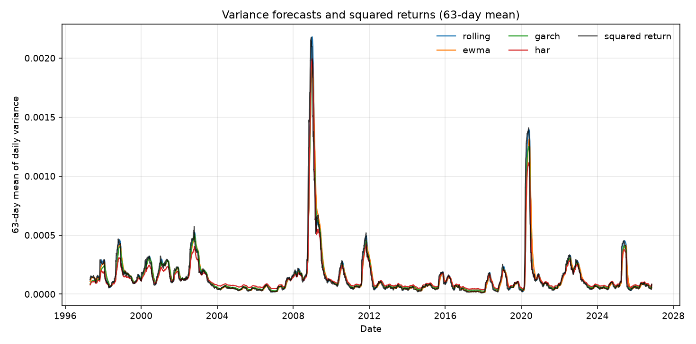
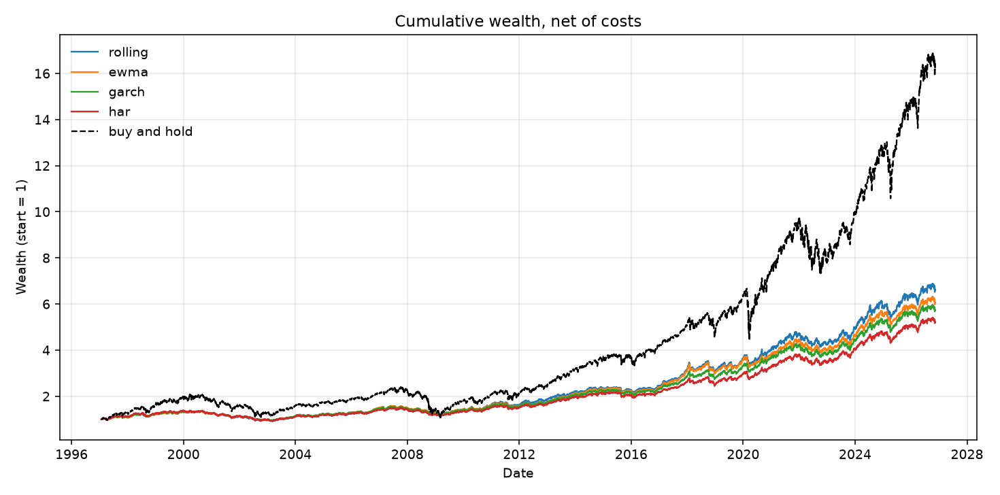
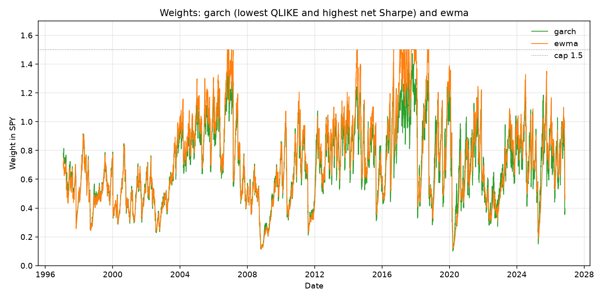

# Volatility targeting on SPY

## The question

Does a better volatility forecast also give steadier risk, smaller drawdowns, or lower turnover when the trading rule is held fixed? I keep the rule the same and only change the variance forecast that goes into it. The forecasts are scored on squared returns, and the same dates are then run through the rule.

The book is long SPY. Anything not in SPY sits in cash. The weight is set at the prior close and applied to the next day's simple return.

## Frozen choices

Adjusted close, simple returns, Yahoo Finance. The weight is

`w = min(1.5, 0.10 / sigma_annual)`, with `sigma_annual = sqrt(forecast * 252)`.

No shorting. Every forecast is floored at a 5% annual volatility before the weight is computed and before QLIKE. The trading cost is 1 basis point times the absolute weight change, subtracted from that day's return. Gross returns use the same weights with the cost set to zero. The first weight change is from a flat position.

The first 1008 trading days are estimation only. All four forecasts are scored on the same later dates: 1997-01-27 through 2026-11-12 (7497 days).

The forecasts are a 21-day sample variance, RiskMetrics EWMA with lambda 0.94, a Gaussian GARCH(1,1) with a constant mean refit every 21 days, and a HAR regression refit on the same schedule. HAR here uses squared daily returns, not intraday realized volatility.

Buy-and-hold SPY (weight 1, no cost) is a reference row in the strategy table. It is not a fifth forecast and it is not ranked.

Sharpe is mean daily return over its standard deviation, annualized with sqrt(252). Cash earns zero, so this is not an excess return over T-bills.

## How to run

```bash
pip install -r requirements.txt
python main.py
```

If `data/spy.csv` is already there and not empty, the script uses that file instead of downloading again.

## Results

Numbers below are from the CSVs written by `main.py`. Rank 1 is best among the four forecasts. Decision ranks use net returns. A smaller drawdown (less negative) ranks ahead of a larger one.

### Forecast scores

Lower is better. QLIKE is `log(forecast) + squared_return / forecast`.

| model | mse | qlike |
| --- | ---: | ---: |
| rolling | 2.538279e-07 | -8.1555 |
| ewma | 2.418959e-07 | -8.2070 |
| garch | 2.333972e-07 | -8.2464 |
| har | 2.440921e-07 | -8.2025 |

### Strategy stats

| model | ann vol net | ann vol gross | tracking RMSE net | tracking RMSE gross | max DD net | max DD gross | turnover | Sharpe net | Sharpe gross | cap share |
| --- | ---: | ---: | ---: | ---: | ---: | ---: | ---: | ---: | ---: | ---: |
| rolling | 0.109957 | 0.109957 | 0.028765 | 0.028764 | -0.3354 | -0.3346 | 6.959 | 0.6335 | 0.6398 | 0.0428 |
| ewma | 0.105059 | 0.105059 | 0.027021 | 0.027021 | -0.3148 | -0.3142 | 5.725 | 0.6301 | 0.6355 | 0.0180 |
| garch | 0.100798 | 0.100798 | 0.022951 | 0.022951 | -0.3172 | -0.3164 | 6.974 | 0.6338 | 0.6407 | 0 |
| har | 0.100118 | 0.100118 | 0.026575 | 0.026574 | -0.3411 | -0.3389 | 9.870 | 0.6056 | 0.6155 | 0 |
| buy and hold | 0.193507 | 0.193507 | 0.121829 | 0.121829 | -0.5519 | -0.5519 | 0 | 0.5829 | 0.5829 | 0 |

### Ranks

Full sample (7497 days).

| model | qlike | rank | tracking RMSE | rank | max DD | rank | Sharpe net | rank | turnover | rank |
| --- | ---: | ---: | ---: | ---: | ---: | ---: | ---: | ---: | ---: | ---: |
| rolling | -8.1555 | 4 | 0.028765 | 4 | -0.3354 | 3 | 0.6335 | 2 | 6.959 | 2 |
| ewma | -8.2070 | 2 | 0.027021 | 3 | -0.3148 | 1 | 0.6301 | 3 | 5.725 | 1 |
| garch | -8.2464 | 1 | 0.022951 | 1 | -0.3172 | 2 | 0.6338 | 1 | 6.974 | 3 |
| har | -8.2025 | 3 | 0.026575 | 2 | -0.3411 | 4 | 0.6056 | 4 | 9.870 | 4 |

2008-01-01 through 2009-12-31 (505 days).

| model | qlike | rank | tracking RMSE | rank | max DD | rank | Sharpe net | rank | turnover | rank |
| --- | ---: | ---: | ---: | ---: | ---: | ---: | ---: | ---: | ---: | ---: |
| rolling | -7.1255 | 3 | 0.023653 | 2 | -0.2103 | 2 | -0.2174 | 3 | 3.972 | 2 |
| ewma | -7.1425 | 2 | 0.023834 | 3 | -0.2050 | 1 | -0.1886 | 1 | 3.292 | 1 |
| garch | -7.1534 | 1 | 0.022022 | 1 | -0.2114 | 3 | -0.2167 | 2 | 4.019 | 3 |
| har | -7.1228 | 4 | 0.024284 | 4 | -0.2187 | 4 | -0.2438 | 4 | 8.140 | 4 |

Calendar 2020 (253 days).

| model | qlike | rank | tracking RMSE | rank | max DD | rank | Sharpe net | rank | turnover | rank |
| --- | ---: | ---: | ---: | ---: | ---: | ---: | ---: | ---: | ---: | ---: |
| rolling | -7.2668 | 4 | 0.046122 | 4 | -0.1144 | 3 | 0.9959 | 2 | 5.956 | 2 |
| ewma | -7.2836 | 3 | 0.044175 | 3 | -0.1243 | 4 | 0.6930 | 4 | 4.779 | 1 |
| garch | -7.4551 | 1 | 0.031732 | 1 | -0.1080 | 1 | 1.0740 | 1 | 7.857 | 3 |
| har | -7.4318 | 2 | 0.033542 | 2 | -0.1112 | 2 | 0.9856 | 3 | 8.065 | 4 |

Calendar 2022 (251 days).

| model | qlike | rank | tracking RMSE | rank | max DD | rank | Sharpe net | rank | turnover | rank |
| --- | ---: | ---: | ---: | ---: | ---: | ---: | ---: | ---: | ---: | ---: |
| rolling | -7.3121 | 3 | 0.018815 | 4 | -0.1260 | 2 | -0.9366 | 3 | 4.051 | 2 |
| ewma | -7.3419 | 1 | 0.017388 | 3 | -0.1310 | 4 | -0.9673 | 4 | 3.440 | 1 |
| garch | -7.3256 | 2 | 0.014844 | 1 | -0.1283 | 3 | -0.9182 | 2 | 7.046 | 3 |
| har | -7.3120 | 4 | 0.017277 | 2 | -0.1255 | 1 | -0.7967 | 1 | 7.644 | 4 |

Evaluation days outside those three windows (6488 days).

| model | qlike | rank | tracking RMSE | rank | max DD | rank | Sharpe net | rank | turnover | rank |
| --- | ---: | ---: | ---: | ---: | ---: | ---: | ---: | ---: | ---: | ---: |
| rolling | -8.3029 | 4 | 0.028697 | 4 | -0.3354 | 3 | 0.7415 | 3 | 7.343 | 3 |
| ewma | -8.3593 | 2 | 0.026801 | 3 | -0.3148 | 1 | 0.7519 | 1 | 6.040 | 1 |
| garch | -8.3980 | 1 | 0.022953 | 1 | -0.3172 | 2 | 0.7497 | 2 | 7.167 | 2 |
| har | -8.3510 | 3 | 0.026800 | 2 | -0.3411 | 4 | 0.7247 | 4 | 10.161 | 4 |

## Plots

The variance plot is a 63-day mean, so the daily series is readable. Squared returns are the target the scores use.



Cumulative net wealth starts at 1. Buy-and-hold is the dashed line.



GARCH has the best QLIKE and the best net Sharpe, so the weight chart is GARCH plus EWMA.



## What I take from this

On the full sample, GARCH has the lowest QLIKE and the lowest MSE. The other three finish in the same order on both losses: EWMA, then HAR, then the 21-day rolling variance. It also has the smallest tracking RMSE against the 10% target, and the highest net Sharpe. The Sharpe margin is tiny: 0.634 versus 0.633 for the 21-day rolling variance, and 0.630 for EWMA. EWMA has the smallest max drawdown (-31.5% versus -31.7% for GARCH) and the lowest turnover. So the best forecast score lines up with steadier risk around the target, and only barely with Sharpe. It does not line up with a smaller drawdown or lower turnover.

HAR's full-sample volatility (10.01%) is the closest of the four to 10%, but its tracking RMSE is worse than GARCH's. Average volatility and the path of 21-day volatility are not the same thing here. HAR also has the highest turnover.

The ranks split once the sample is cut up.

- In 2008-2009, GARCH still wins QLIKE and tracking error. EWMA has the least-bad Sharpe, the smallest drawdown, and the lowest turnover. All four Sharpes are negative.
- In 2020, GARCH wins QLIKE, tracking, drawdown, and Sharpe. EWMA still has the lowest turnover.
- In 2022, EWMA wins QLIKE, not GARCH. GARCH still tracks the target best. HAR has the smallest drawdown and the least-bad Sharpe. EWMA has the lowest turnover and the worst Sharpe in that year.
- Outside those windows, GARCH again wins QLIKE and tracking. EWMA wins Sharpe, drawdown, and turnover.

Each rule's full-sample max drawdown matches its drawdown in that outside bucket. The three stress windows are milder than that (about -11% to -22%, against about -31% to -34% for the full sample).

All four rules land near the 10% volatility target (10.0% to 11.0%), against 19.4% for buy-and-hold. Their net Sharpes are a bit above buy-and-hold's 0.58, and their max drawdowns are smaller than buy-and-hold's -55%. The wealth chart still finishes lower for the four rules, which spend a lot of time below full investment. A 1bp cost does not change who wins on Sharpe, tracking error, or drawdown. GARCH and HAR never sit on the 1.5 cap. Rolling is there on about 4.3% of days, EWMA on about 1.8%.

I would not make much of the full-sample Sharpe ranking. GARCH, rolling, and EWMA are within 0.004 of each other.

## References

- Fleming, Kirby, and Ostdiek (2001), Journal of Finance. "The Economic Value of Volatility Timing."
- Fleming, Kirby, and Ostdiek (2003), Journal of Financial Economics. "The Economic Value of Volatility Timing Using 'Realized' Volatility."
- Moreira and Muir (2017), Journal of Finance. "Volatility-Managed Portfolios."
- Corsi (2009), Journal of Financial Econometrics. "A Simple Approximate Long-Memory Model of Realized Volatility."
- Patton (2011), Journal of Econometrics. "Volatility Forecast Comparison Using Imperfect Volatility Proxies."
- J.P. Morgan / Reuters (1996). RiskMetrics Technical Document.
